# nxt-draw

**English** · [**Français**](#version-française)

**A pixel art editor for tiles, tilemaps and animations.**
Draw like in a photo editor (layers, groups, clipping masks, selections, transforms), assemble your tiles into orthogonal or isometric maps, animate them, or build keyframed animations you can export as video. Maps export to [Tiled](https://www.mapeditor.org/).

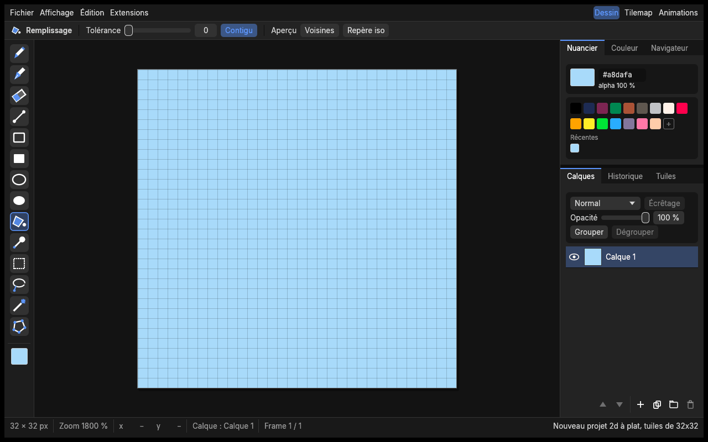

> **Extreme alpha.** The project is young: features and workflows are still evolving, and file formats may change between versions. Export your drawings to PNG to be safe.
>
> This repository hosts the **releases** and the documentation. Download the latest build from the [Releases page](https://github.com/next-vertices/nxt-drawer/releases).
>
> The interface is currently in **French**.
>
> **© Next-Vertices. All rights reserved.** Any copy, redistribution or other use without the publisher's prior written authorization is prohibited: see the [legal notice](#legal-notice).

## Contents

- [Download and install](#download-and-install)
- [Features](#features)
- [Demo projects](#demo-projects)
- [Keyboard shortcuts](#keyboard-shortcuts)
- [Settings](#settings)
- [Feedback](#feedback)
- [Legal notice](#legal-notice)

## Download and install

Get the file for your platform from the [Releases](https://github.com/next-vertices/nxt-drawer/releases). Stable versions are listed normally; beta builds are marked **Pre-release**.

| System | File | How to install |
|---|---|---|
| **Windows 64-bit** | `nxt-draw-windows-x64.zip` | Portable: unzip and run `nxt-draw.exe`. Nothing to install. |
| | `nxt-draw-windows-x64.msi` | Installer: Start menu entry, uninstall, updates. |
| **macOS** (Apple Silicon and Intel) | `nxt-draw-macos-universal.zip` | Unzip and drag the app to *Applications*. It is **not notarized**: on first launch, right-click it and choose **Open**. |
| **Debian / Ubuntu** | `nxt-draw_<version>_amd64.deb` | `sudo apt install ./nxt-draw_*.deb` |
| **Fedora** | `nxt-draw-<version>-1.x86_64.rpm` | `sudo dnf install ./nxt-draw-*.rpm` |
| **Arch Linux** | `nxt-draw-<version>-1-x86_64.pkg.tar.zst` | `sudo pacman -U nxt-draw-*.pkg.tar.zst` |

Checksums are published in `SHA256SUMS.txt` next to each release.

**Requirements.** On Linux, a Vulkan or OpenGL graphics driver is needed.

**Video export.** ffmpeg is bundled with the Windows installer and zip. On macOS and Linux, install it yourself (`brew install ffmpeg`, `sudo apt install ffmpeg`, …) or point to it in *Settings → Files*. The formats offered are the ones your ffmpeg can encode.

**Launch option.** `nxt-draw --iso3d` enables the experimental isometric 3D (voxel) drawing, hidden by default.

## Features

### Four project types

*File → New project* (`Ctrl+N`) shows a preview at real scale of what you are about to create.

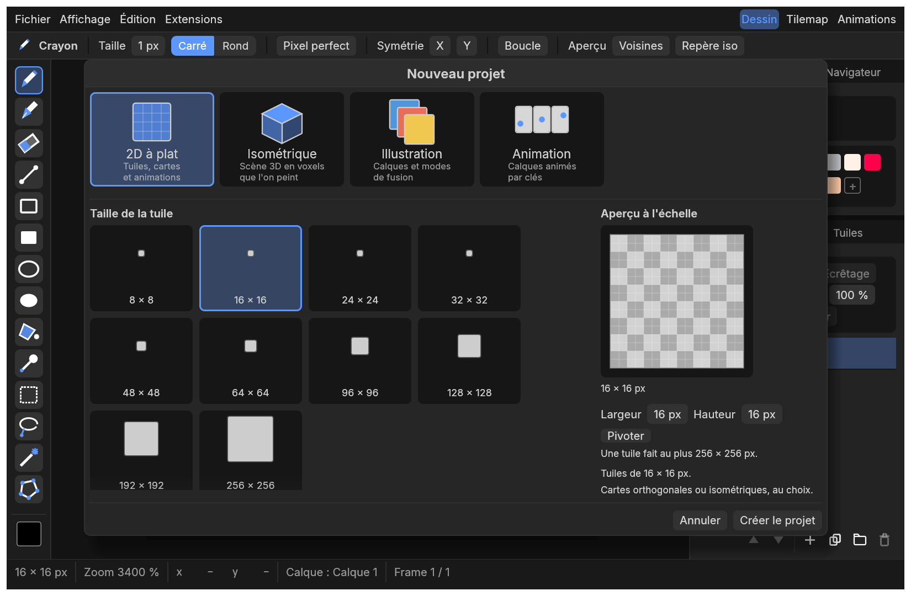

| Type | What it is for |
|---|---|
| **2D flat** | Tiles, maps (orthogonal or isometric 2:1) and tile animations: the Draw, Tilemap and Animations modes. |
| **Isometric** | Like flat, plus the isometric grid, volumes, planes and the voxel scene (needs `--iso3d`). |
| **Illustration** | One big layered pixel-art canvas, no tiles or maps. Ready-made sizes (pixel art, screen, web, mobile, paper, icons), portrait / landscape, transparent / white / black / colored background. |
| **Animation** | A canvas whose layers and objects move through keyframes on a timeline, with the frame rate and length of your choice. Ends up as a video. |

Tiles are at most 256 × 256 px.

### Drawing

Draw mode edits one tile (or the illustration canvas) at a time, as a full sprite: layers, groups, clipping masks, animation frames. Press `V` to switch between Draw and Tilemap.

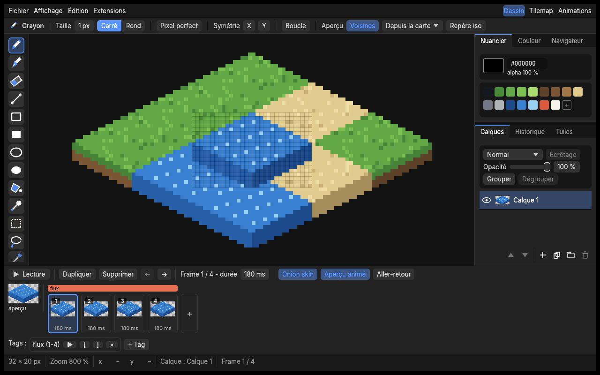

- **Pencil**: 1 to 64 px, square or round, *pixel perfect*, X / Y mirror, **wrap-around** drawing for seamless tiles.
- **Pressure-sensitive pen** (`N`): the stroke width varies smoothly between an adjustable min and max. With a **stylus**, pressure comes from the force; with a **mouse**, from the speed (slow = thick, fast = thin).
- **Eraser with protected colors**: a list of colors the eraser leaves alone, with a tolerance for similar shades, and a switch to turn it off without clearing the list.
- **Shapes**: line, rectangle, ellipse (outline or filled), adjustable thickness. **Fill** with tolerance, **color picker** (it also reads neighbouring tiles).
- **Neighbours**: see the tiles actually next to yours on the map, to match textures and make variants.
- **Right-click** on the canvas opens the active tool's settings in a floating panel (long press on a touch screen).
- Pixel grid, guides, onion skin, zoom to cursor, navigator, clickable history, editable palette (PICO-8 by default), color picker, recent colors, "replace everywhere" for a palette color.

### Layers

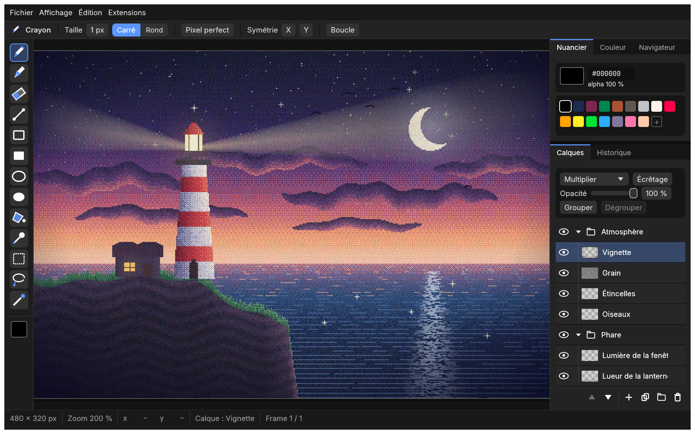

- Visibility, opacity, rename, **lock**.
- Nestable **groups**, merged as a block.
- **13 blend modes**: Normal, Multiply, Screen, Overlay, Darken, Lighten, Add, Difference, Soft light, Hard light, Color dodge, Color burn, Exclusion. Applied in exports too.
- **Clipping masks**: a clipped layer only shows where its base layer is opaque.
- **Drag and drop** to reorder or move into a group.
- **Multi-layer selection** (`Ctrl+click`, `Shift+click`): group, ungroup, clip, show / hide, lock, duplicate, delete together, each as **a single history entry**.

### Selection and transform

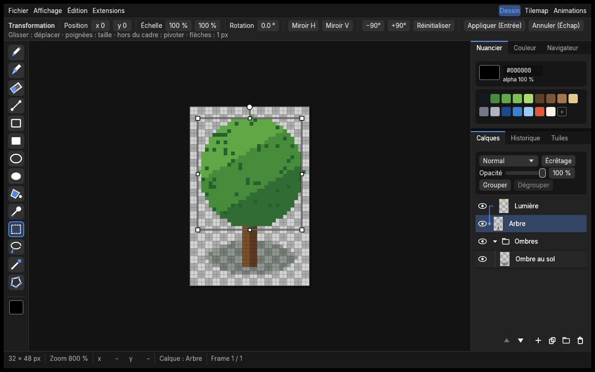

- **Rectangle**, **lasso** and **magic wand** selections, combinable (`Shift` adds, `Alt` subtracts, both intersect), invert.
- Copy, cut, paste: pasted pixels **float** until you place them.
- **Free transform** (`Ctrl+T`) without smoothing: move, scale from a handle, rotate, flip, numeric values.

### Tilemap

Tiles from your library are placed on **multi-layer maps**, orthogonal or isometric 2:1. Editing a tile updates every map, and animated tiles play right on the map.

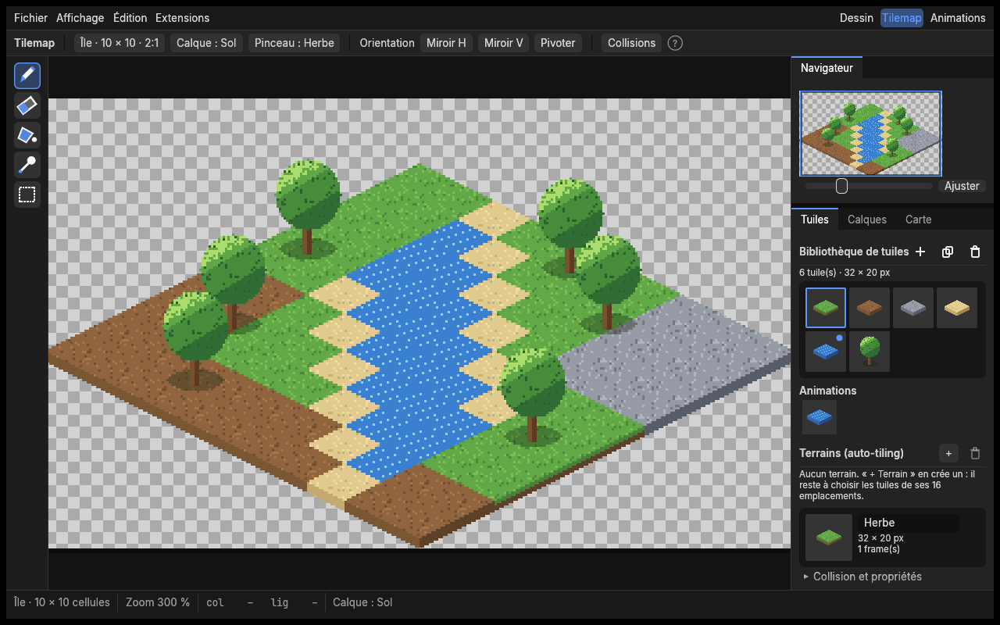

- Tile library, several maps per project, several **map layers** (drag to reorder, per-layer opacity).
- Paint, erase, flood fill, pick; flip or rotate tiles as you place them (`X`, `Y`, `Z`).
- **Cell selection** (`M`): copy, cut, paste, clear and move areas of the map.

**Auto-tiling.** A *terrain* maps tiles to neighbour combinations: 16 tiles (four sides) or **47 tiles** (with inner and outer corners). While painting, each cell picks its own edge, corner or inside, and its neighbours adjust (also when erasing or filling). A terrain can **join** another one (a wall and its door).

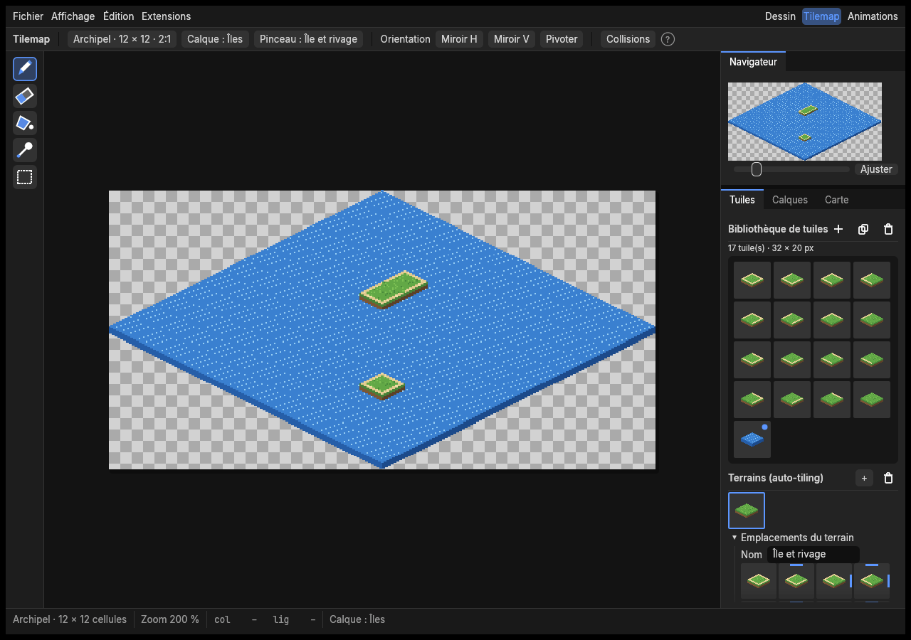

**Corner terrains (Wang).** A 16-tile terrain handles the transition between two terrains: you paint the grid **vertices** (click = upper terrain, right-click = lower) and each cell picks its tile from its four corners. Works on orthogonal and isometric maps.

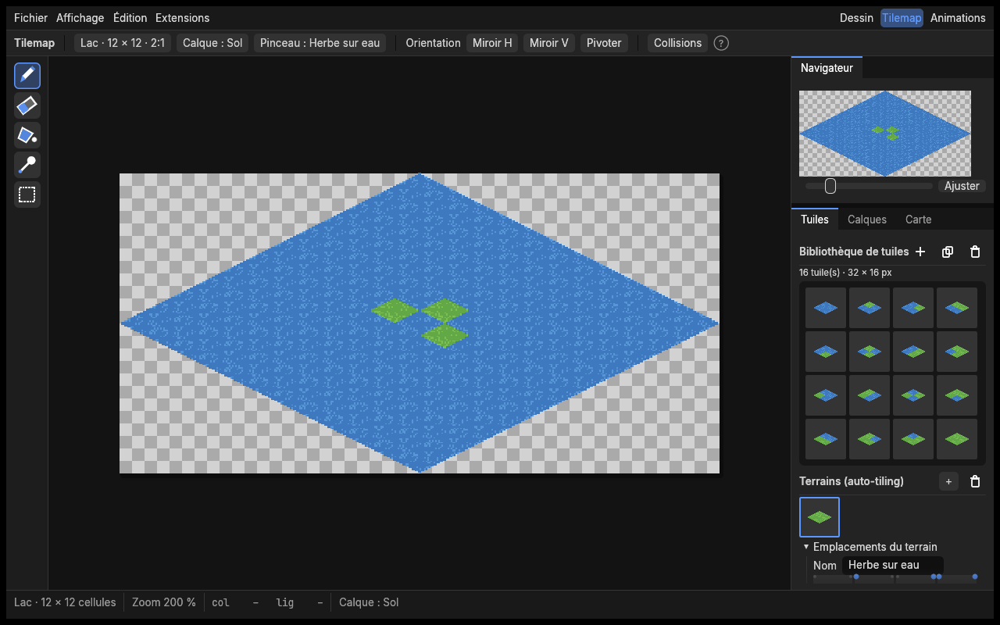

**Collisions and properties.** Each tile has a *Solid* flag, a class and free properties, plus **drawn collision shapes** (rectangles and polygons, `K`). The *Collisions* button shows solid cells in red. Everything is exported to Tiled.

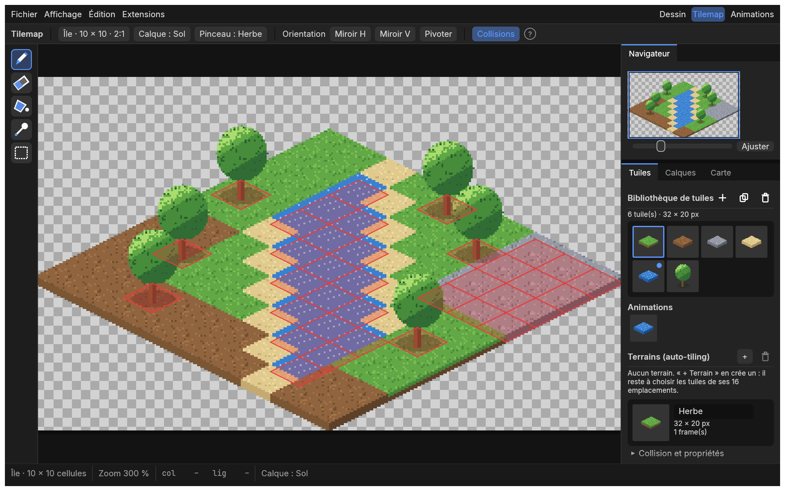

### Tile animations

A tile drawn with several frames gets its animation **automatically**, kept in sync. The **Animations** mode (`F4`) also lets you build free sequences (frames from several tiles, per-frame duration) and place them on maps like a tile.

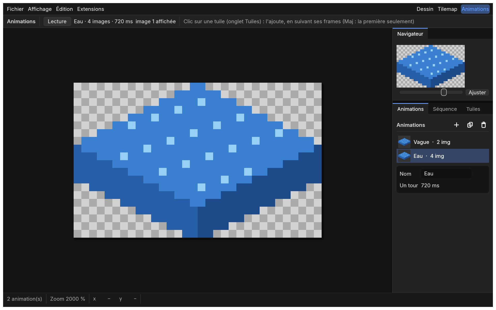

In Draw mode, the **timeline** (`Alt+T`) manages frames: durations, duplication, reordering, **tags** ("walk", "jump"…), looping or ping-pong playback, and **onion skin**.

### Keyframed animation projects

An **Animation** project is a pixel-art canvas whose layers move. Instead of redrawing every image, you set **keys**: at this frame, this layer is at this position, angle, opacity. Everything in between is computed, **pixel-exact**.

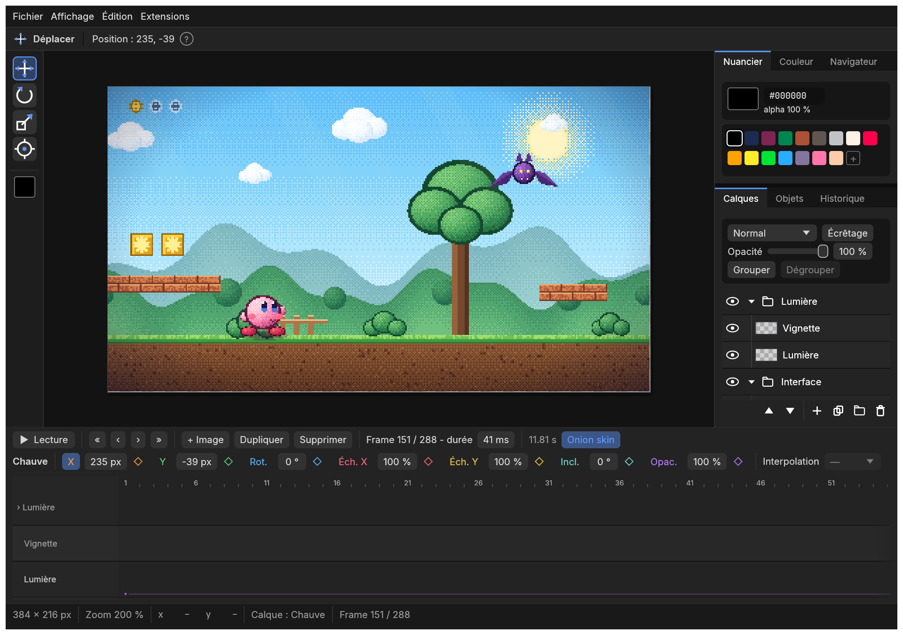

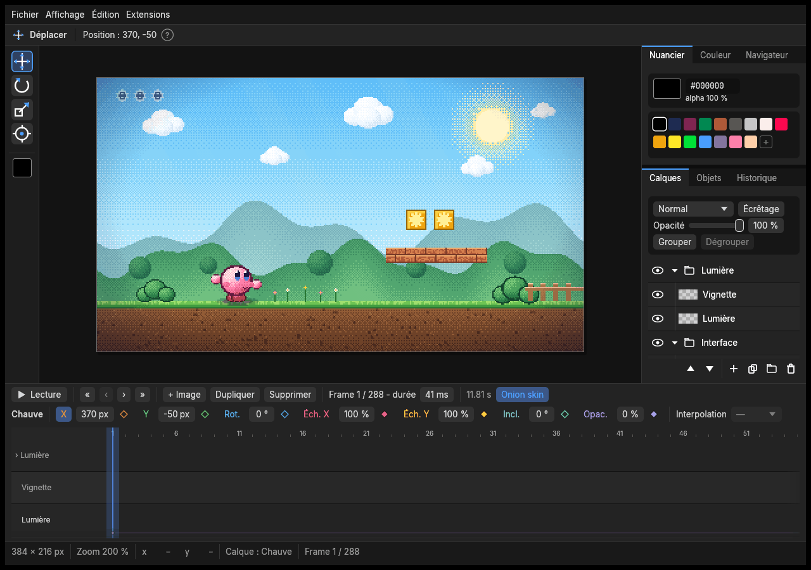

- **Seven animatable properties**: position X / Y, rotation, scale X / Y, skew, opacity.
- **Per-key interpolation**: *Linear*, *Smooth*, or *Step*.
- **Move** (`T`), **Rotate** (`U`), **Scale** (`Y`) and **Pivot** (`J`) tools: drag in the canvas and keys are set for you.
- **Objects**: multi-layer drawings (a tree: shadows, trunk, leaves…) kept in a library and placed as many times as you like. Editing an object updates all its instances.
- **Held frames**: a layer's drawing stays visible until the next one, so a single drawing is moved by keys, and several drawings play a pose cycle.
- Resizable timeline, per-property key grid, previous / next key, onion skin.
- **Reveal a stroke** (`Alt+R`): plays your last stroke over N frames so a drawing appears progressively.

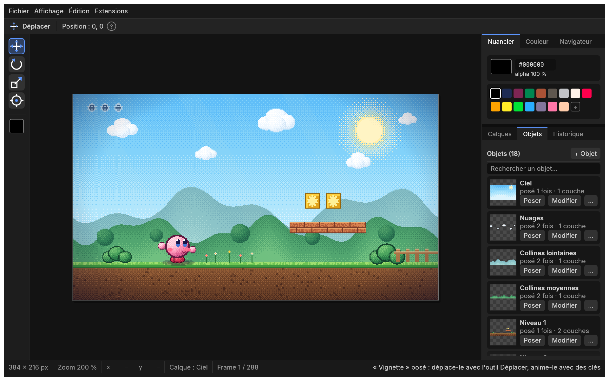

### Isometric 3D drawing (experimental)

Paint a **voxel** scene, MagicaVoxel-style: shapes (block, stairs, ramp, cylinder, sphere), brush, eraser, fill, lines and rectangles on surfaces, mirror, **four view angles**, rendered 2:1 into a "Scene" layer. Pixel layers stay free on top for details. Start the app with `--iso3d` to enable it.

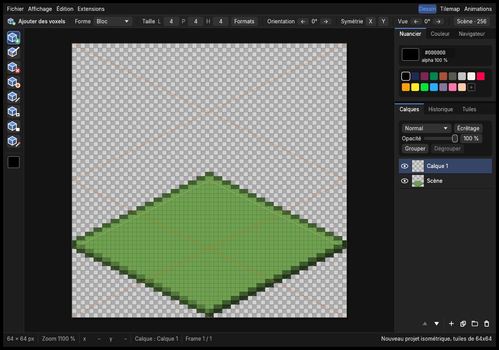

### Extensions (plugins)

nxt-draw can be extended with small **WebAssembly** programs running in a sandbox: one `plugin.wasm` file for Windows, Linux and macOS.

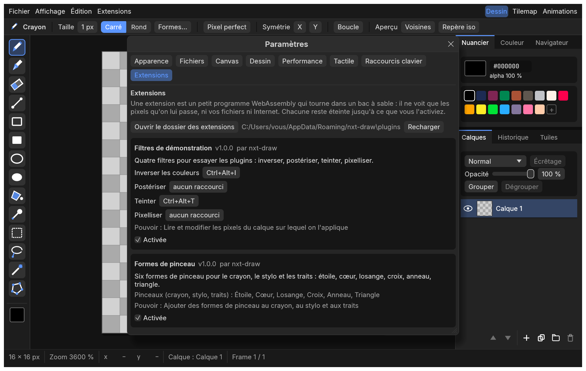

- **Safe**: a plugin only sees the pixels of the layer you give it: no files, no network, no clock. It is off until you enable it, and is stopped if it runs too long, uses too much memory or crashes. Everything it does is undoable.
- **Actions** (filters, effects) in the *Extensions* menu, with settings and a suggested shortcut you stay in control of.
- **Brush shapes** for the pencil, pen and strokes.

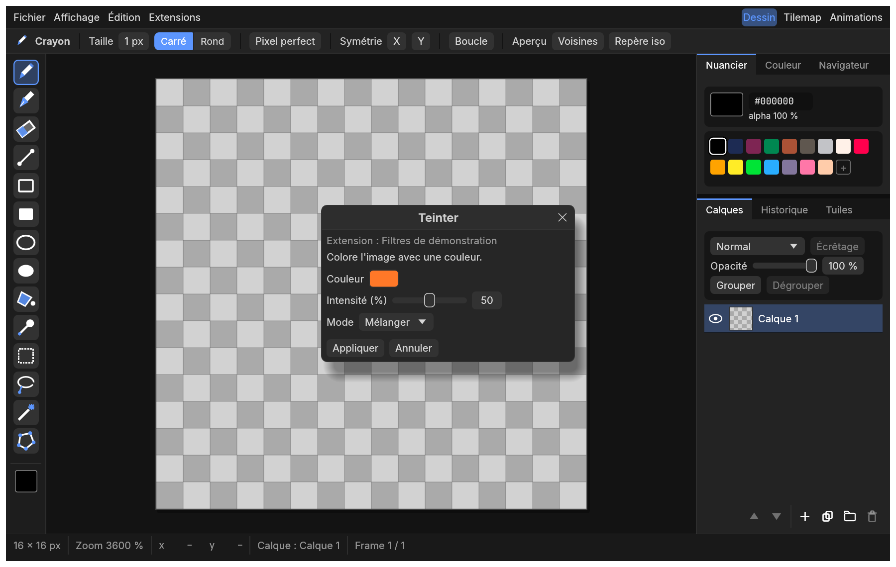
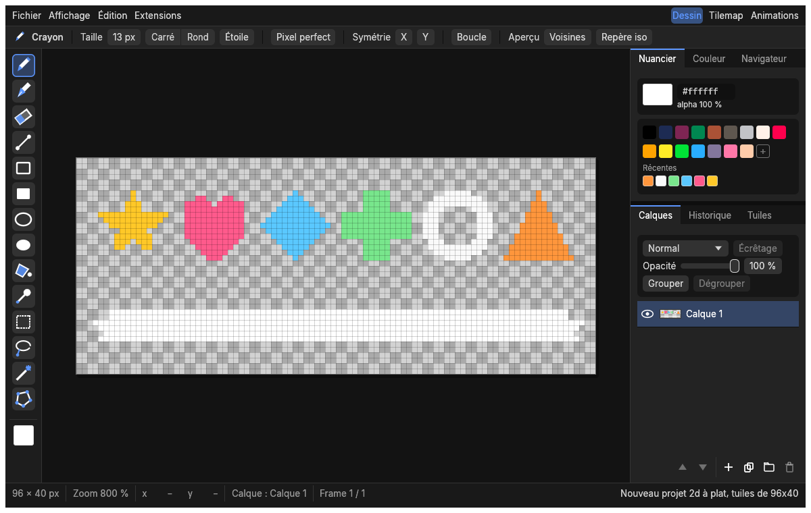

To install a plugin, copy its folder (with `manifest.json` and `plugin.wasm`) into *Settings → Extensions → Open the extensions folder*, click **Reload**, then tick **Enabled**.

### Files and exports

- Project **`.nxp`** (tiles, maps, animations, scene); single drawing **`.nxd`**.
- **PNG** with integer upscaling, **animated GIF**, **spritesheet + JSON** (frames, durations, tags).
- **MP4 / WebM video** through ffmpeg: crisp upscaling, fixed frame rate, quality, background or transparency, repeats, progress and cancel.
- **Windows `.ico`** (16–256 px) and **macOS `.icns`** (16–512 px) from any drawing, and a full **favicon set** for the web in one go.
- Maps as **Tiled** (`.tmj` + tileset image, animations included).

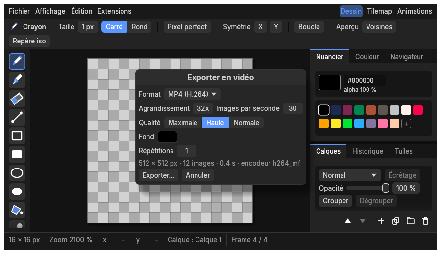

### Interface and comfort

- Photoshop-style **panel dock** (swatches, color, navigator, layers, history, tiles, objects) and a contextual options bar.
- Light, dark or system **themes**, accent color, interface scale.
- **Touch and stylus**: one finger draws, pinch zooms, two fingers pan, triple tap undoes, long press opens tool settings.
- Automatic **recovery copy** after a crash.
- **Fully remappable shortcuts**, with Photoshop and Aseprite presets.

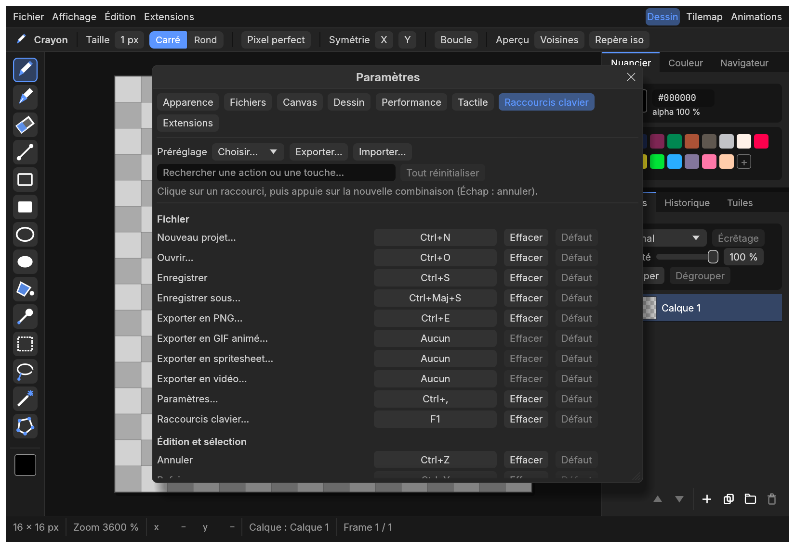

## Demo projects

Nine of these demo projects ship **inside the app** (*File → Examples*). They open as an unnamed project, so the original is never modified. All ten are also in [`examples/`](examples): download them and open them with *File → Open*.

| Type | Project | What it shows |
|---|---|---|
| Animation | **Pouf, a platformer level** | A round character crosses a scrolling level and swallows three enemies. 12 seconds, ready to export as 1920 × 1080 video. ([`pouf-plateformer.nxp`](examples/pouf-plateformer.nxp)) |
| Animation | **The rose losing its petals** | A 14-layer object, falling petals, light effects (halo, beams, bokeh, dust) and the table reflection. ([`rose-petales.nxp`](examples/rose-petales.nxp)) |
| Animation | **Animated landscape** | Objects in three planes: a rotating sun, clouds, trees swaying around their base, a bird. ([`animation-demo.nxp`](examples/animation-demo.nxp)) |
| Tilemap | **Village** | A 40 × 26 map: path and lake terrains that join by themselves, animated water, tall houses, collisions. ([`village-tilemap.nxp`](examples/village-tilemap.nxp)) |
| Tilemap | **Isometric island** | A diagonal river, a stone plateau, trees and animated water. ([`ile-isometrique.nxp`](examples/ile-isometrique.nxp)) |
| Tilemap | **Terrains (archipelago)** | Islands whose shores draw themselves with a 16-tile terrain. ([`terrains.nxp`](examples/terrains.nxp)) |
| Tilemap | **Corner terrains (Wang)** | A lake painted vertex by vertex. ([`terrain-wang.nxp`](examples/terrain-wang.nxp)) |
| Illustration | **Lighthouse at dusk** | 35 layers in 5 groups, every blend mode, a clipping mask. ([`phare-illustration.nxp`](examples/phare-illustration.nxp)) |
| Illustration | **Icon (glowing cube)** | A 128 × 128 icon with gradient, shadow, cube, shine and sparkles. ([`icone-illustration.nxp`](examples/icone-illustration.nxp)) |
| Isometric | **Voxel scene** | Blocks, stairs, ramp, cylinder and sphere (needs `--iso3d`). ([`scene-voxels.nxp`](examples/scene-voxels.nxp)) |

## Keyboard shortcuts

All shortcuts can be changed in **Edit → Keyboard shortcuts…** (`F1`). Defaults:

| Area | Keys | Action |
|---|---|---|
| Tools | `B` `N` `E` `L` `R` `O` `G` `I` | Pencil, pressure pen, eraser, line, rectangle, ellipse, fill, picker (`Shift`: filled rectangle / ellipse) |
| | `M` `Q` `W` `K` | Rectangle select, lasso, magic wand, collision |
| | `T` `U` `Y` `J` | Move, rotate, scale, pivot (Animation projects) |
| Brush | `[` `]` | Brush size |
| | `Alt+X` `Alt+Y` `Alt+P` `Alt+W` | Mirror X, mirror Y, pixel perfect, wrap-around |
| | `X` | Swap with previous color |
| File | `Ctrl+N` `Ctrl+O` `Ctrl+S` `Ctrl+Shift+S` | New, open, save, save as |
| | `Ctrl+E` | Export PNG |
| | `Ctrl+,` `F1` `F11` | Settings, shortcuts, full screen |
| Edit | `Ctrl+Z` / `Ctrl+Y` | Undo / redo |
| | `Ctrl+C` `Ctrl+X` `Ctrl+V` `Del` | Copy, cut, paste (pasted pixels float: move, then `Enter`), delete |
| | `Ctrl+A` `Ctrl+D` `Ctrl+Shift+I` | Select all, deselect, invert selection |
| | `Ctrl+T` | Free transform (`Enter` confirms, arrows: 1 px, `Shift`: 10 px) |
| View | `F` / `Shift+F` | Fit to window / 1:1 |
| | `+` `-` | Zoom |
| | `Space` + drag | Pan (or middle click) |
| | `Alt+G` `Alt+O` | Pixel grid, onion skin |
| | `Tab` | Hide / show all panels |
| | `Alt+T` | Show / hide the timeline |
| | `V` `F2` `F3` `F4` | Toggle Draw / Tilemap, Draw, Tilemap, Animations |
| Layers | `Ctrl+Shift+N` `Ctrl+J` | New layer, duplicate |
| | `Ctrl+G` `Ctrl+Shift+G` `Ctrl+Alt+G` | Group, ungroup, clipping mask |
| | `Ctrl+]` `Ctrl+[` | Move layer up / down |
| | `Ctrl+H` `Ctrl+L` | Show / hide, lock |
| Frames | `Shift+Space` | Play / pause |
| | `.` `,` `Home` `End` | Next, previous, first, last frame |
| | `Alt+N` `Alt+Shift+N` | New frame, duplicate frame |
| Animation | `Alt+K` `Alt+Shift+K` | Toggle a key, set position keys (X and Y) |
| | `Alt+,` `Alt+.` | Previous / next key |
| | arrows | Nudge the layer by 1 px (`Shift`: 10 px) |
| | `Alt+←` `Alt+→` / `Alt+↑` `Alt+↓` | Rotate / scale the layer |
| | `Alt+Enter` `Alt+I` | Enter the object, place another instance |
| | `Alt+R` | Reveal the last stroke over N frames |
| Map | `X` `Y` `Z` | Flip the tile to place (horizontal, vertical) or rotate it a quarter turn |

## Settings

*Edit → Settings…* (`Ctrl+,`). Tabs: **Appearance** (theme, accent, interface scale), **Files** (recovery copy, recent files, export scale, ffmpeg path), **Canvas** (zoom, transparency checkerboard, pixel grid, cursor), **Drawing** (start tool, pixel perfect, stroke smoothing, onion skin), **Performance**, **Touch**, **Keyboard shortcuts** and **Extensions**.

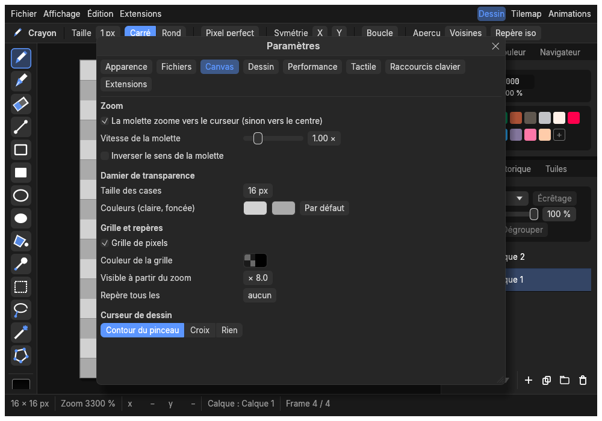

## Feedback

This is an early alpha: bug reports and ideas are very welcome. Open an [issue](https://github.com/next-vertices/nxt-drawer/issues) and tell us your platform, the version (from the release name) and, if possible, the project file.

Repository: <https://github.com/next-vertices/nxt-drawer>

## Legal notice

**© Next-Vertices. All rights reserved.**

nxt-draw, its binaries, installers, name, icon, documentation, screenshots, animations and demo projects distributed in this repository are the exclusive property of **Next-Vertices**.

Any copy, reproduction, redistribution, publication, modification, reverse engineering, resale or other use of this software or of its content, in whole or in part, in any form or by any means, is **prohibited without the prior written authorization of the publisher, Next-Vertices**.

The software is provided free of charge for personal use as published in the [Releases](https://github.com/next-vertices/nxt-drawer/releases); this does not grant any license or right beyond that use. It is provided "as is", without warranty of any kind.

Third-party components keep their own licenses (for example, the bundled fonts Inter and JetBrains Mono are under the SIL Open Font License 1.1).

---

# Version française

**Éditeur de pixel art pour tuiles, tilemaps et animations.**
On dessine comme dans un logiciel de retouche (calques, groupes, masques d'écrêtage, sélections, transformations), puis on assemble les tuiles en cartes orthogonales ou isométriques, on les anime, ou on compose des animations à clés exportables en vidéo. Les cartes s'exportent vers [Tiled](https://www.mapeditor.org/).

> **Alpha très précoce.** Le projet est jeune : les fonctionnalités et les façons de faire évoluent encore, et les formats de fichier peuvent changer d'une version à l'autre. Pense à exporter tes dessins en PNG.
>
> Ce dépôt héberge les **releases** et la documentation. Télécharge la dernière version dans la page [Releases](https://github.com/next-vertices/nxt-drawer/releases).
>
> **© Next-Vertices. Tous droits réservés.** Toute copie, diffusion ou autre utilisation sans l'autorisation écrite préalable de l'éditeur est interdite : voir les [mentions légales](#mentions-légales).

## Sommaire

- [Télécharger et installer](#télécharger-et-installer)
- [Fonctionnalités](#fonctionnalités)
- [Projets de démonstration](#projets-de-démonstration)
- [Raccourcis clavier](#raccourcis-clavier)
- [Paramètres](#paramètres)
- [Retours](#retours)
- [Mentions légales](#mentions-légales)

## Télécharger et installer

Télécharge le fichier de ta plateforme dans les [Releases](https://github.com/next-vertices/nxt-drawer/releases). Les versions stables sont listées normalement ; les builds beta sont marqués **Pre-release**.

| Système | Fichier | Installation |
|---|---|---|
| **Windows 64 bits** | `nxt-draw-windows-x64.zip` | Portable : décompresse et lance `nxt-draw.exe`. Rien à installer. |
| | `nxt-draw-windows-x64.msi` | Installeur : menu Démarrer, désinstallation, mises à jour. |
| **macOS** (Apple Silicon et Intel) | `nxt-draw-macos-universal.zip` | Décompresse et glisse l'application dans *Applications*. Elle n'est **pas notariée** : au premier lancement, clic droit puis **Ouvrir**. |
| **Debian / Ubuntu** | `nxt-draw_<version>_amd64.deb` | `sudo apt install ./nxt-draw_*.deb` |
| **Fedora** | `nxt-draw-<version>-1.x86_64.rpm` | `sudo dnf install ./nxt-draw-*.rpm` |
| **Arch Linux** | `nxt-draw-<version>-1-x86_64.pkg.tar.zst` | `sudo pacman -U nxt-draw-*.pkg.tar.zst` |

Les sommes de contrôle sont dans `SHA256SUMS.txt`, à côté de chaque release.

**Prérequis.** Sous Linux, il faut un pilote graphique Vulkan ou OpenGL.

**Export vidéo.** ffmpeg est livré avec l'installeur et le zip Windows. Sous macOS et Linux, installe-le (`brew install ffmpeg`, `sudo apt install ffmpeg`…) ou indique le programme dans *Paramètres → Fichiers*. Les formats proposés sont ceux que ton ffmpeg sait encoder.

**Option de lancement.** `nxt-draw --iso3d` active le dessin 3D isométrique (voxels), expérimental et masqué par défaut.

## Fonctionnalités

### Quatre types de projet

*Fichier → Nouveau projet* (`Ctrl+N`) montre un aperçu à l'échelle de ce qu'on va créer.

| Type | Pour quoi faire |
|---|---|
| **2D à plat** | Des tuiles, des cartes (orthogonales ou isométriques 2:1) et des animations de tuiles : les modes Dessin, Tilemap et Animations. |
| **Isométrique** | Comme le précédent, avec en plus la grille, les volumes, les plans et la scène en voxels (nécessite `--iso3d`). |
| **Illustration** | Un grand canvas de pixel art à calques, sans tuiles ni carte. Formats prêts à l'emploi (pixel art, écran, web, mobile, papier, icônes), portrait / paysage, fond transparent, blanc, noir ou en couleur. |
| **Animation** | Un canvas dont les calques et les objets bougent par clés sur une timeline, avec la cadence et la durée de ton choix. Se termine en vidéo. |

Les tuiles font au plus 256 × 256 px.

### Dessiner

Le mode Dessin édite une tuile (ou le canvas d'une illustration) à la fois, comme un sprite complet : calques, groupes, masques d'écrêtage, frames d'animation. La touche `V` bascule entre Dessin et Tilemap.

- **Crayon** : de 1 à 64 px, carré ou rond, *pixel perfect*, symétrie X / Y, dessin **en boucle** pour les tuiles qui se raccordent.
- **Stylo sensible à la pression** (`N`) : la taille du trait varie en douceur entre un mini et un maxi réglables. Avec un **stylet**, la pression vient de la force d'appui ; à la **souris**, de la vitesse (lent = épais, rapide = fin).
- **Gomme à couleurs protégées** : une liste de couleurs que la gomme laisse en place, avec une tolérance pour les teintes voisines, et un interrupteur pour la couper sans vider la liste.
- **Formes** : ligne, rectangle, ellipse (contour ou plein), épaisseur réglable. **Remplissage** avec tolérance, **pipette** (elle lit aussi les tuiles voisines).
- **Voisines** : on voit les tuiles réellement voisines dans la carte autour de celle qu'on retouche, pour raccorder les textures et faire des variantes.
- **Clic droit** sur le canvas : les réglages de l'outil actif dans un petit panneau flottant (appui long sur écran tactile).
- Grille de pixels, repères, onion skin, zoom vers le curseur, navigateur, historique cliquable, palette éditable (PICO-8 par défaut), sélecteur de couleur, couleurs récentes, « remplacer partout » une couleur de la palette.

### Calques

- Visibilité, opacité, renommage, **verrouillage**.
- **Groupes** emboîtables, fusionnés en bloc.
- **13 modes de fusion** : Normal, Multiplier, Écran, Superposition, Obscurcir, Éclaircir, Addition, Différence, Lumière douce, Lumière crue, Densité couleur −/+, Exclusion. Appliqués aussi aux exports.
- **Masques d'écrêtage** : un calque écrêté ne se voit que là où son calque de base est opaque.
- **Glisser-déposer** pour réordonner ou ranger dans un groupe.
- **Sélection de plusieurs calques** (`Ctrl+clic`, `Maj+clic`) : grouper, dégrouper, écrêter, afficher / masquer, verrouiller, dupliquer, supprimer ensemble, chaque opération étant **une seule entrée d'historique**.

### Sélection et transformation

- Sélections au **rectangle**, au **lasso** et à la **baguette magique**, combinables (`Maj` ajoute, `Alt` retire, les deux croisent), inversion.
- Copier, couper, coller : le collage arrive en **pixels flottants** qu'on place avant de les poser.
- **Transformation libre** (`Ctrl+T`) sans lissage : déplacer, redimensionner depuis une poignée, pivoter, retourner, valeurs numériques.

### Tilemap

Les tuiles de la bibliothèque se posent sur des **cartes à plusieurs calques**, orthogonales ou isométriques 2:1. Retoucher une tuile met toutes les cartes à jour, et les tuiles animées jouent directement sur la carte.

- Bibliothèque de tuiles, plusieurs cartes par projet, plusieurs **calques de carte** (glisser pour réordonner, opacité par calque).
- Pose, gomme, remplissage de zone, pipette ; tuiles retournées ou pivotées à la pose (`X`, `Y`, `Z`).
- **Sélection de cellules** (`M`) : copier, couper, coller, effacer et déplacer des zones de la carte.

**Auto-tiling.** Un *terrain* associe des tuiles aux combinaisons de voisines : 16 tuiles (quatre côtés) ou **47 tuiles** (avec les coins rentrants et sortants). En peignant, chaque cellule choisit seule son bord, son coin ou son intérieur, et ses voisines se réajustent (aussi en effaçant ou en remplissant). Un terrain peut **se raccorder à** un autre (un mur et sa porte).

**Terrains par les coins (Wang).** Un terrain de 16 tuiles fait la transition entre deux terrains : on peint les **sommets** de la grille (clic = terrain du dessus, clic droit = dessous) et chaque cellule choisit sa tuile selon ses quatre coins. Cartes orthogonales et isométriques.

**Collisions et propriétés.** Chaque tuile a un drapeau *Solide*, une classe et des propriétés libres, plus des **formes de collision dessinées** (rectangles et polygones, `K`). Le bouton *Collisions* montre les cases solides en rouge. Tout est exporté vers Tiled.

### Animations de tuiles

Une tuile dessinée avec plusieurs frames reçoit **automatiquement son animation**, qui la suit en direct. Le mode **Animations** (`F4`) permet aussi de composer des séquences libres (images de plusieurs tuiles, durée par image) et de les poser sur les cartes comme une tuile.

En mode Dessin, la **timeline** (`Alt+T`) gère les frames : durées, duplication, réordonnancement, **tags** (« marche », « saut »…), lecture simple ou aller-retour, **onion skin**.

### Projets Animation à clés

Un projet **Animation** est un canvas de pixel art dont les calques bougent. Au lieu de redessiner chaque image, on pose des **clés** : à telle frame, tel calque est à telle position, tel angle, telle opacité. Tout ce qui est entre deux clés est calculé, **au pixel près**.

- **Sept propriétés animables** : position X / Y, rotation, échelle X / Y, inclinaison, opacité.
- **Interpolation par clé** : *Linéaire*, *Doux* ou *Palier*.
- Outils **Déplacer** (`T`), **Tourner** (`U`), **Échelle** (`Y`) et **Pivot** (`J`) : on glisse dans le canvas, les clés se posent seules.
- **Objets** : des dessins à plusieurs couches (un arbre : ombres, tronc, feuilles…) rangés dans une bibliothèque et posés autant de fois qu'on veut. Modifier l'objet met à jour toutes ses instances.
- **Images tenues** : le dessin d'un calque reste affiché jusqu'au prochain dessin ; un seul dessin est déplacé par les clés, plusieurs dessins jouent un cycle de poses.
- Timeline redimensionnable, grille de clés par propriété, clé précédente / suivante, onion skin.
- **Révéler un trait** (`Alt+R`) : joue le dernier trait sur N images pour qu'un dessin apparaisse petit à petit.

### Dessin 3D isométrique (expérimental)

On peint une scène de **voxels**, à la MagicaVoxel : formes (bloc, escalier, pente, cylindre, sphère), pinceau, gomme, remplissage, lignes et rectangles sur les surfaces, symétrie, **quatre angles de vue**, rendu 2:1 dans un calque « Scène ». Les calques de pixels restent libres au-dessus pour les détails. Lance l'application avec `--iso3d` pour l'activer.

### Extensions (plugins)

nxt-draw s'étend avec de petits programmes **WebAssembly** qui tournent dans un bac à sable : un seul fichier `plugin.wasm` pour Windows, Linux et macOS.

- **Sûr** : un plugin ne voit que les pixels du calque qu'on lui passe : pas de fichiers, pas de réseau, pas d'horloge. Il est éteint tant qu'on ne l'a pas activé, et arrêté s'il calcule trop longtemps, prend trop de mémoire ou plante. Tout ce qu'il fait est annulable.
- **Actions** (filtres, effets) dans le menu *Extensions*, avec leurs réglages et un raccourci suggéré que tu gardes la main pour changer.
- **Formes de pinceau** pour le crayon, le stylo et les traits.

Pour installer un plugin, copie son dossier (avec `manifest.json` et `plugin.wasm`) dans *Paramètres → Extensions → Ouvrir le dossier des extensions*, clique sur **Recharger**, puis coche **Activée**.

### Fichiers et exports

- Projet **`.nxp`** (tuiles, cartes, animations, scène) ; dessin seul **`.nxd`**.
- **PNG** avec agrandissement entier, **GIF animé**, **spritesheet + JSON** (frames, durées, tags).
- **Vidéo MP4 / WebM** par ffmpeg : agrandissement net, cadence fixe, qualité, fond ou transparence, répétitions, progression et annulation.
- **Icône Windows `.ico`** (16 à 256 px) et **macOS `.icns`** (16 à 512 px) depuis n'importe quel dessin, et un **jeu de favicons** web généré d'un coup.
- Cartes au format **Tiled** (`.tmj` + image des tuiles, animations comprises).

### Interface et confort

- **Dock de panneaux** façon Photoshop (nuancier, couleur, navigateur, calques, historique, tuiles, objets) et barre d'options contextuelle.
- **Thèmes** clair, sombre ou celui du système, couleur d'accent, taille de l'interface.
- **Écran tactile et stylet** : un doigt dessine, pincer zoome, deux doigts déplacent la vue, un triple tap annule, un appui long ouvre les réglages de l'outil.
- **Copie de récupération** automatique après un plantage.
- **Raccourcis entièrement personnalisables**, avec préréglages Photoshop et Aseprite.

## Projets de démonstration

Neuf de ces projets sont livrés **dans l'application** (*Fichier → Exemples*). Ils s'ouvrent comme un projet sans nom : l'original n'est jamais modifié. Les dix sont aussi dans [`examples/`](examples) : télécharge-les et ouvre-les avec *Fichier → Ouvrir*.

| Type | Projet | Ce qu'il montre |
|---|---|---|
| Animation | **Pouf, un niveau de plateformer** | Un petit personnage rond traverse un niveau qui défile et aspire trois ennemis. 12 secondes, à exporter en vidéo 1920 × 1080. ([`pouf-plateformer.nxp`](examples/pouf-plateformer.nxp)) |
| Animation | **La rose qui perd ses pétales** | Un objet à 14 couches, des pétales qui tombent, des jeux de lumière (halo, faisceaux, bokeh, poussières) et le reflet de la table. ([`rose-petales.nxp`](examples/rose-petales.nxp)) |
| Animation | **Paysage animé** | Des objets posés dans trois plans : un soleil qui tourne, des nuages, des arbres qui oscillent, un oiseau. ([`animation-demo.nxp`](examples/animation-demo.nxp)) |
| Tilemap | **Village** | Une carte de 40 × 26 cases : terrains de chemin et de lac qui se raccordent seuls, eau animée, maisons hautes, collisions. ([`village-tilemap.nxp`](examples/village-tilemap.nxp)) |
| Tilemap | **Île isométrique** | Rivière en diagonale, plateau de pierre, arbres et eau animée. ([`ile-isometrique.nxp`](examples/ile-isometrique.nxp)) |
| Tilemap | **Terrains (archipel)** | Des îles dont le rivage se dessine tout seul avec un terrain à 16 tuiles. ([`terrains.nxp`](examples/terrains.nxp)) |
| Tilemap | **Terrains par les coins (Wang)** | Un lac peint sommet par sommet. ([`terrain-wang.nxp`](examples/terrain-wang.nxp)) |
| Illustration | **Le phare au crépuscule** | 35 calques en 5 groupes, tous les modes de fusion, un masque d'écrêtage. ([`phare-illustration.nxp`](examples/phare-illustration.nxp)) |
| Illustration | **Icône (cube lumineux)** | Une icône de 128 × 128 : dégradé, ombre, cube, brillance et étincelles. ([`icone-illustration.nxp`](examples/icone-illustration.nxp)) |
| Isométrique | **Scène de voxels** | Bloc, escalier, pente, cylindre et sphère (nécessite `--iso3d`). ([`scene-voxels.nxp`](examples/scene-voxels.nxp)) |

## Raccourcis clavier

Tous les raccourcis se changent dans **Édition → Raccourcis clavier…** (`F1`). Valeurs par défaut :

| Rubrique | Touches | Action |
|---|---|---|
| Outils | `B` `N` `E` `L` `R` `O` `G` `I` | Crayon, stylo sensible à la pression, gomme, ligne, rectangle, ellipse, remplissage, pipette (`Maj` : rectangle et ellipse pleins) |
| | `M` `Q` `W` `K` | Sélection rectangulaire, lasso, baguette magique, collision |
| | `T` `U` `Y` `J` | Déplacer, tourner, échelle, pivot (projets Animation) |
| Pinceau | `[` `]` | Taille du pinceau |
| | `Alt+X` `Alt+Y` `Alt+P` `Alt+W` | Symétrie X, symétrie Y, pixel perfect, dessin en boucle |
| | `X` | Alterner avec la couleur précédente |
| Fichier | `Ctrl+N` `Ctrl+O` `Ctrl+S` `Ctrl+Maj+S` | Nouveau, ouvrir, enregistrer, enregistrer sous |
| | `Ctrl+E` | Exporter en PNG |
| | `Ctrl+,` `F1` `F11` | Paramètres, raccourcis clavier, plein écran |
| Édition | `Ctrl+Z` / `Ctrl+Y` | Annuler / refaire |
| | `Ctrl+C` `Ctrl+X` `Ctrl+V` `Suppr` | Copier, couper, coller (le collage flotte : déplace puis `Entrée`), supprimer |
| | `Ctrl+A` `Ctrl+D` `Ctrl+Maj+I` | Tout sélectionner, désélectionner, inverser la sélection |
| | `Ctrl+T` | Transformation libre (`Entrée` valide, flèches : 1 px, `Maj` : 10 px) |
| Affichage | `F` / `Maj+F` | Ajuster à la fenêtre / zoom 1:1 |
| | `+` `-` | Zoom |
| | `Espace` + glisser | Déplacer la vue (ou clic milieu) |
| | `Alt+G` `Alt+O` | Grille de pixels, onion skin |
| | `Tab` | Masquer / afficher tous les panneaux |
| | `Alt+T` | Afficher / masquer la timeline |
| | `V` `F2` `F3` `F4` | Basculer Dessin / Tilemap, mode Dessin, Tilemap, Animations |
| Calques | `Ctrl+Maj+N` `Ctrl+J` | Nouveau calque, dupliquer |
| | `Ctrl+G` `Ctrl+Maj+G` `Ctrl+Alt+G` | Grouper, dégrouper, masque d'écrêtage |
| | `Ctrl+]` `Ctrl+[` | Monter, descendre le calque |
| | `Ctrl+H` `Ctrl+L` | Afficher / masquer, verrouiller |
| Frames | `Maj+Espace` | Lecture / pause |
| | `.` `,` `Début` `Fin` | Frame suivante, précédente, première, dernière |
| | `Alt+N` `Alt+Maj+N` | Nouvelle frame, dupliquer la frame |
| Animation | `Alt+K` `Alt+Maj+K` | Poser / retirer une clé, poser des clés de position (X et Y) |
| | `Alt+,` `Alt+.` | Clé précédente, suivante |
| | flèches | Pousser le calque d'un pixel (`Maj` : 10 px) |
| | `Alt+←` `Alt+→` / `Alt+↑` `Alt+↓` | Tourner / agrandir le calque |
| | `Alt+Entrée` `Alt+I` | Entrer dans l'objet, poser une autre instance |
| | `Alt+R` | Jouer le dernier trait sur N images |
| Carte | `X` `Y` `Z` | Retourner la tuile à poser (horizontal, vertical) ou la pivoter d'un quart de tour |

## Paramètres

*Édition → Paramètres…* (`Ctrl+,`). Onglets : **Apparence** (thème, accent, taille de l'interface), **Fichiers** (copie de récupération, fichiers récents, agrandissement d'export, chemin de ffmpeg), **Canvas** (zoom, damier de transparence, grille de pixels, curseur), **Dessin** (outil de départ, pixel perfect, lissage du trait, onion skin), **Performance**, **Tactile**, **Raccourcis clavier** et **Extensions**.

## Retours

C'est une alpha très précoce : les rapports de bugs et les idées sont les bienvenus. Ouvre une [issue](https://github.com/next-vertices/nxt-drawer/issues) en indiquant ta plateforme, la version (celle du nom de la release) et, si possible, le fichier de projet.

Dépôt : <https://github.com/next-vertices/nxt-drawer>

## Mentions légales

**© Next-Vertices. Tous droits réservés.**

nxt-draw, ses exécutables, installeurs, son nom, son icône, sa documentation, ses captures, animations et projets de démonstration distribués dans ce dépôt sont la propriété exclusive de **Next-Vertices**.

Toute copie, reproduction, redistribution, diffusion, modification, rétro-ingénierie, revente ou autre utilisation de ce logiciel ou de son contenu, en tout ou partie, sous quelque forme et par quelque moyen que ce soit, est **interdite sans l'autorisation écrite préalable de l'éditeur, Next-Vertices**.

Le logiciel est fourni gratuitement pour un usage personnel, tel que publié dans les [Releases](https://github.com/next-vertices/nxt-drawer/releases) ; cela n'accorde aucune licence ni aucun droit au-delà de cet usage. Il est fourni « en l'état », sans garantie d'aucune sorte.

Les composants tiers conservent leur propre licence (par exemple, les polices Inter et JetBrains Mono embarquées sont sous SIL Open Font License 1.1).

